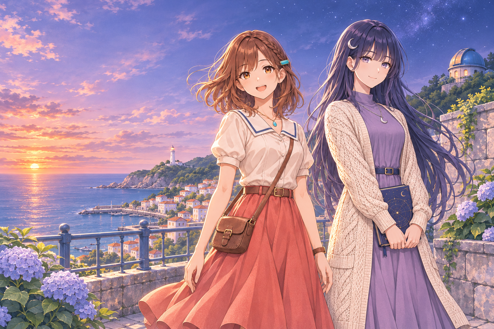

# 潮汐来信 · Letters of the Tide

原创全年龄 Galgame **第一阶段美术素材包**。主题是海边小镇、夏日来信与旧天文台；两位可攻略角色均为成年人。所有 PNG 由内置 `image_gen` 工具生成，角色差分和场景变体使用基准图作为参考。



## 素材内容

| 类别 | 数量 | 内容 |
| --- | ---: | --- |
| 角色设计图 | 2 | 夏澄、澪的正背面、配色、配饰、表情参考 |
| 透明全身立绘 | 12 | 每人日常、喜悦、害羞、惊讶、认真、落泪六种表情 |
| 场景背景 | 8 | 海堤日景／夕照、咖啡馆晴天／雨天、旧车站黄昏、卧室夜晚、天文台外景／内部 |
| 剧情 CG | 2 | 夏澄的海玻璃来信、澪的观星之约 |
| 双人主视觉 | 1 | 无文字版，可叠加正式标题和菜单 |
| **合计** | **25 张** | 独立原始 PNG，非缩略图或占位文件 |

## 预览

随仓库提供的 [preview/index.html](preview/index.html) 可切换背景、两位角色的表情、透明棋盘底和全身构图。无需安装前端依赖，在仓库目录运行：

```bash
python -m http.server 8000
# 浏览 http://localhost:8000/preview/
```

## 文件布局

```text
assets/
  design/                  # 两张角色参考设计图
  characters/{natsumi,mio}/ # 每人六张透明立绘
  backgrounds/             # 八张无人物场景
  cg/                      # 两张单人剧情插画
  keyart/                  # 双人主视觉
  manifest.json            # 实测尺寸、透明通道、锚点建议、SHA-256
docs/
  art-direction.md         # 世界观、人物与视觉规范
  integration.md           # 引擎接入与画幅说明
  generation-notes.md      # 生成方法与后续扩图约束
preview/                   # 本地素材预览与场景合成
scripts/audit_assets.py    # 检查完整性并更新素材清单
```

## 接入与校验

立绘原图为 **1024 × 1536 RGBA**，背景／CG／设计图／主视觉为 **1536 × 1024**。横图保留工具原生 3:2 画幅；预览采用 16:9 居中裁切，具体说明见 [接入文档](docs/integration.md)。

```bash
python -m pip install Pillow
python scripts/audit_assets.py
```

人物差分为独立整身图，适合直接换图或短淡入淡出；生成式绘画存在细部与轮廓的轻微漂移，不应当作逐像素对齐的面部图层。设计图上的文字仅为美术参考；正式标题与 UI 应由引擎绘制。

本仓库交付美术素材和预览，不包含完整剧情、音频、角色服装季节变化或成品游戏。当前素材覆盖两条角色线的首轮日常对话、情绪变化及代表性事件；后续新增剧情场景或服装时按视觉规范扩充。
